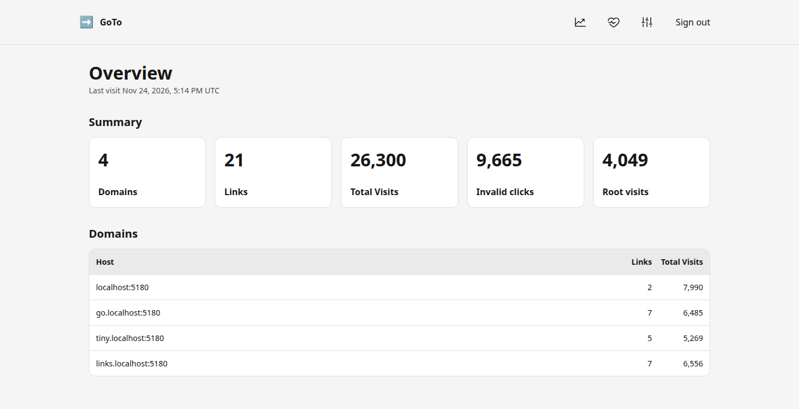

# GoTo

A small, self-hosted URL shortener. Give a long address a short name and get on with it.



One YAML file can run links for several domains. The admin shows what’s configured and how often links are used. To change a link, edit the file.

## Get started

You’ll need Docker Compose and an HTTPS reverse proxy that can reach the Docker host’s loopback address, such as a proxy running directly on that host. Download the [Compose file](compose.yaml). No checkout or build needed.

```sh
mkdir -p goto/config goto/data
cd goto
curl -fsSLo compose.yaml https://git.eleith.com/eleith/goto/raw/branch/main/compose.yaml
```

Save this as `config/goto.yaml`. Replace `go.example.org` with your host in both places.

```yaml
url:
  app: https://go.example.org

auth:
  secret: '${GOTO_AUTH_SECRET}'
  credentials:
    username: admin
    password: '${GOTO_ADMIN_PASSWORD}'

domains:
  go.example.org:
    links:
      /hello:
        url: https://example.org
```

Put `GOTO_ADMIN_PASSWORD` and `GOTO_AUTH_SECRET` in `.env` beside `compose.yaml`. Pick a password and generate a secret with `openssl rand -hex 32`. Keep the same secret across restarts. Make `data/` writable by the containers (UID `1000` on Linux) and back it up.

Point your HTTPS proxy at `http://127.0.0.1:3000`. Preserve `Host` and have the proxy set `X-Real-IP`. The worker isn’t exposed.

```sh
docker compose up --wait
```

Open `/hello` on your host. It should send you on your way. Sign in at `/admin` to see the link. The worker prepares Analytics in the background, so don’t stare at the chart waiting for that first click.

## Documentation

- [Configuration](docs/config.md)
- [Development](docs/development.md)
- [Philosophy](docs/philosophy.md)
- [Testing](docs/testing.md)
- [Screenshots](docs/screenshots.md)
